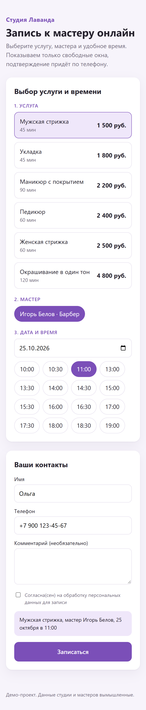
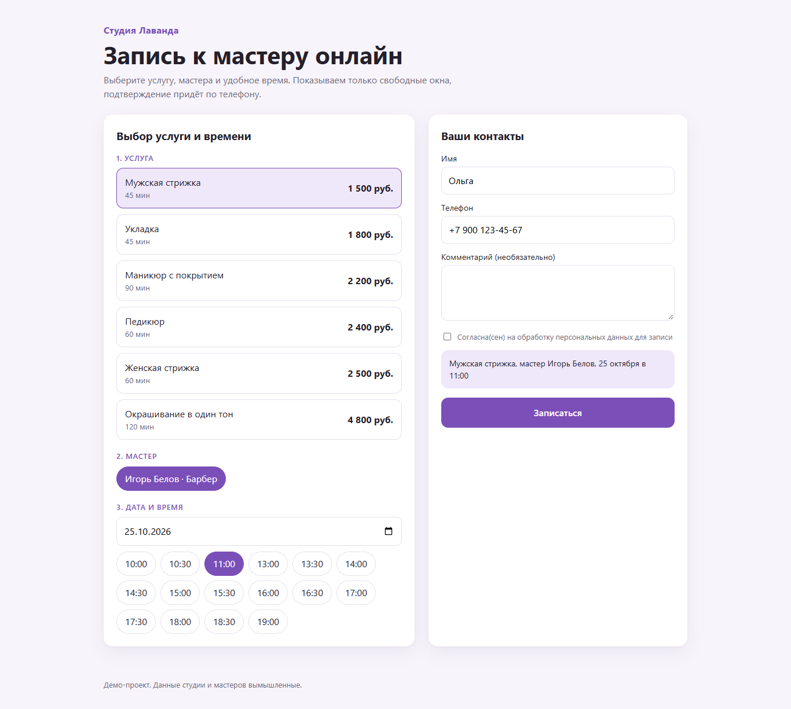
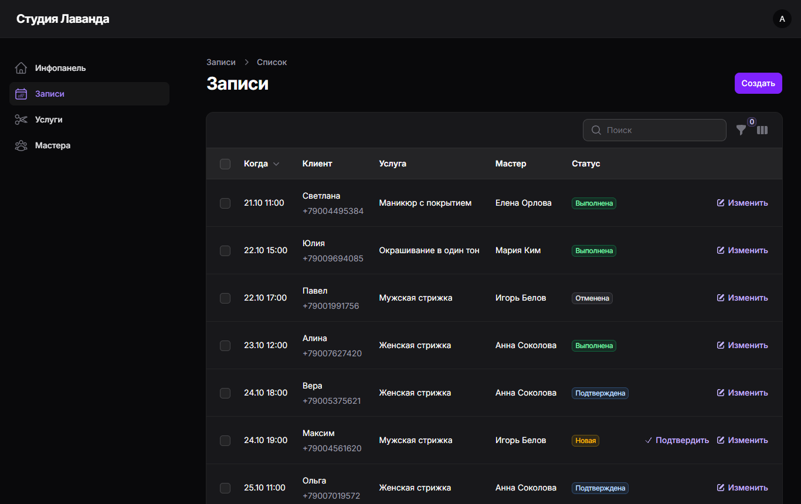
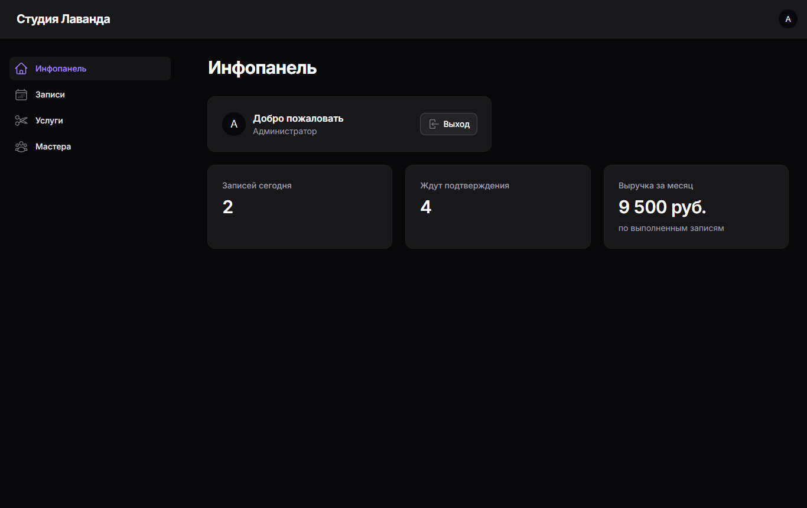
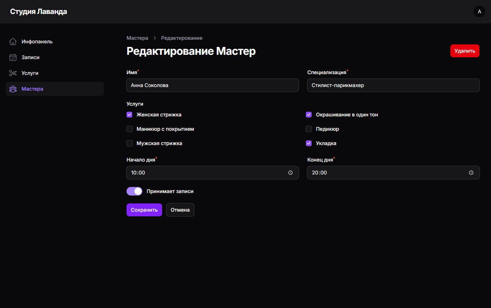

# Онлайн-запись к мастеру на Laravel

Демо-проект для салона или студии услуг: клиент записывается на сайте, администратор ведёт записи, услуги и мастеров в админке. Данные студии и мастеров вымышленные.



## Что умеет

**Страница записи**
- выбор услуги, мастера, даты и свободного времени без перезагрузки страницы;
- показываются только свободные окна: учитываются рабочие часы мастера, длительность услуги и уже занятые записи, прошедшее время сегодня не предлагается;
- маска телефона, приведение номера к формату +7XXXXXXXXXX, согласие на обработку персональных данных, защита от ботов (скрытое поле и ограничение частоты запросов);
- адаптивная вёрстка, удобно с телефона.

**Админка (Filament)**
- инфопанель: записи на сегодня, ожидающие подтверждения, выручка за месяц по выполненным записям;
- записи: фильтры по статусу, мастеру и дате, поиск по имени и телефону, подтверждение в один клик, время окончания считается само по длительности услуги;
- услуги (цена, длительность, показ на сайте) и мастера (рабочие часы, список оказываемых услуг).

**REST API**

| Метод | Адрес | Что делает |
|---|---|---|
| GET | `/api/services` | активные услуги |
| GET | `/api/masters?service_id=` | мастера, которые оказывают услугу |
| GET | `/api/slots?master_id=&service_id=&date=` | свободное время мастера на дату |
| POST | `/api/appointments` | создать запись (те же проверки, что на сайте) |

Запись создаётся в транзакции с повторной проверкой окна, поэтому два клиента не займут одно время.

## Стек

PHP 8.4, Laravel 13, Filament 5, SQLite (подходит MySQL или PostgreSQL), Blade, чистый JS без сборки.

## Запуск

```bash
composer install
cp .env.example .env
php artisan key:generate
php artisan migrate --seed
php artisan serve
```

- сайт: http://127.0.0.1:8000
- админка: http://127.0.0.1:8000/admin, вход `admin@example.com` / `password`

## Тесты

```bash
php artisan test
```

Покрыты: расчёт свободных окон, освобождение времени при отмене, запрет двойной и пересекающейся записи, нормализация телефона, проверка мастера и услуги, согласие и защита от ботов, работа страницы и формы.

## Скриншоты

| Запись на компьютере | Записи в админке |
|---|---|
|  |  |
| **Инфопанель** | **Карточка мастера** |
|  |  |

## Где логика

- `app/Services/SlotService.php`: расчёт свободных окон;
- `app/Actions/CreateAppointment.php`: создание записи с проверкой занятости;
- `app/Http/Requests/StoreAppointmentRequest.php`: проверка данных формы и API;
- `app/Filament/Resources`: админка;
- `tests/Feature/BookingTest.php`: тесты.
